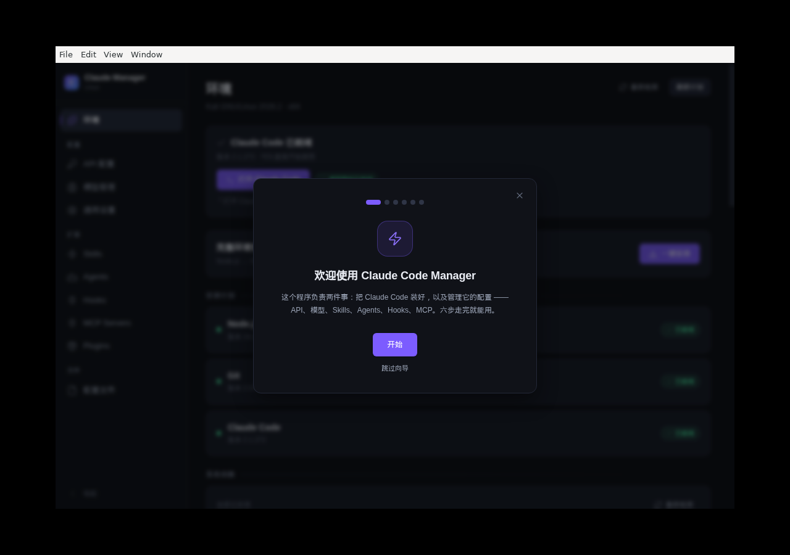
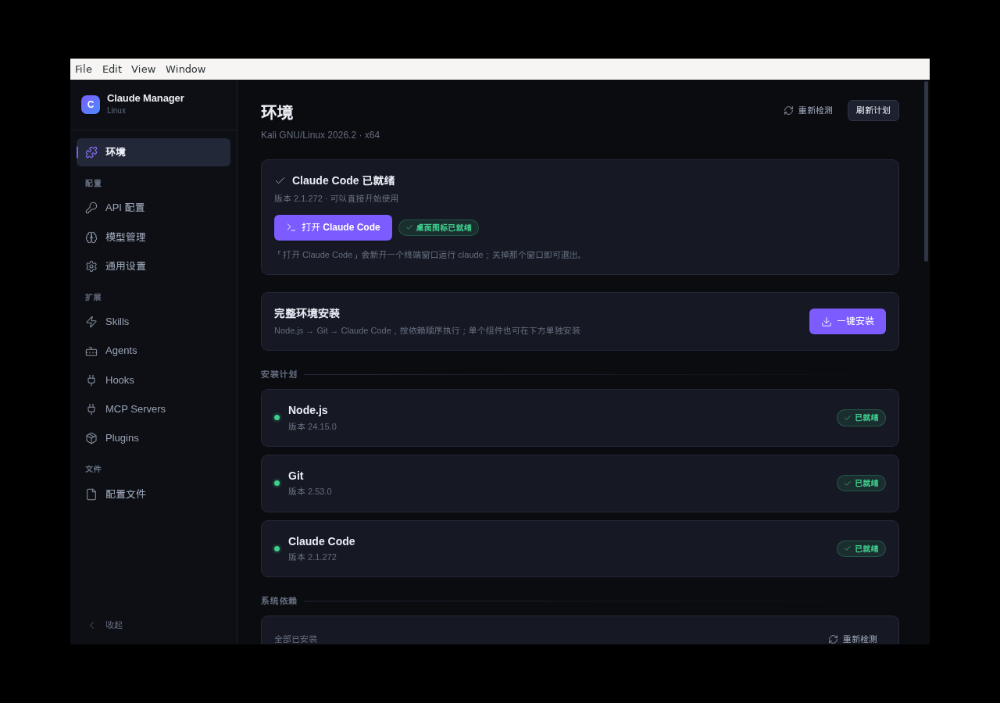
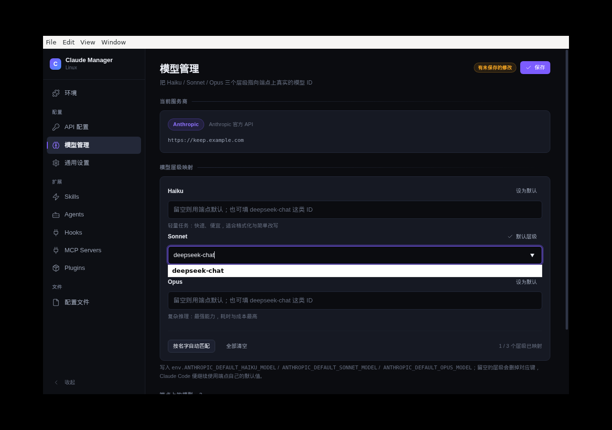

# Claude Code Manager

> Claude Code 一键安装与可视化管理工具 —— Windows 与 Linux（Kali / Debian）双平台

[](https://github.com/RRRadiant/claude-code-manager/actions/workflows/ci.yml)
[](https://github.com/RRRadiant/claude-code-manager/actions/workflows/linux.yml)
[](LICENSE)


---

## 这是什么

**Claude Code Manager (CCM)** 把 Claude Code 的安装和配置过程做成图形界面，另有一个终端 TUI
版本。Windows 与 Linux 各自使用与平台相符的技术栈，功能对齐：装环境、配 API 服务商、
管理模型层级、Skills / Agents / Plugins / Hooks / MCP，全部不用手改 JSON 和 YAML。

面向三类人：

- 第一次接触 Claude Code / AI Agent，不熟悉终端
- 不想手动配环境变量、翻 JSON 配置文件
- 想用图形界面管理 MCP Server 和 API 服务商

## 平台一览

| | Windows 版 | Linux 版（Kali / Debian） |
|---|---|---|
| **技术栈** | Tauri 2 + Rust + React | Electron + React（GUI）/ Rust + ratatui（TUI） |
| **安装包** | `ClaudeCodeManager-x64-portable.exe`、`-setup.exe`、`-setup.msi` | `.deb`（推荐）、AppImage，或单文件 `ccm` |
| **运行要求** | Windows 10 1809+ / 11，WebView2 | Kali / Debian / Ubuntu，x64，glibc |
| **源码位置** | 仓库根目录（`src/`、`src-tauri/`） | [`linux/`](linux/)（`src/`、`cli/`） |
| **说明** | 本文 [Windows 版](#windows-版详细) | [linux/README.md](linux/README.md) |

> Linux 版在 **Kali GNU/Linux 2026.1（x86_64）** 上开发并完成端到端实测，
> 完整验证记录见 [linux/docs/kali-verification.md](linux/docs/kali-verification.md)。

## 版本号

两条桌面线和终端 TUI **各自编号**，仓库没有一个统一的应用版本：

| 组件 | 当前版本 | 记在哪 |
|---|---|---|
| Windows 桌面版（Tauri） | 2.0.1 | 根目录 `package.json`、`src-tauri/Cargo.toml`、`src-tauri/tauri.conf.json` |
| Linux 桌面版（Electron） | 1.3.7 | `linux/package.json`。`.deb` / AppImage 的文件名跟随它 |
| 终端 TUI `ccm` | crate 1.0.0 | `linux/cli/ccm-tui/Cargo.toml`。Release 资产叫 `ccm-linux-x64` 这类名字，不带版本号 |

Git 标签 `v*` 会同时打出 Windows 安装包和 `ccm` 二进制。Linux 安装包仍以 `linux/package.json` 为准，两条桌面线合并之前不会强行改成同一个号。

## 快速开始

### Windows

1. 从 [Releases](https://github.com/RRRadiant/claude-code-manager/releases) 下载
   `ClaudeCodeManager-x64-portable.exe`（便携版，推荐）或 `ClaudeCodeManager-x64-setup.exe` / `.msi`
2. 双击运行
3. 按新手引导走完 7 步向导

> 便携版在 **Windows 10** 上建议与 `MicrosoftEdgeWebview2Setup.exe` 放在同一目录，
> 这样缺少 WebView2 时可以离线静默安装。

### Linux（Kali / Debian / Ubuntu）

从 [Releases](https://github.com/RRRadiant/claude-code-manager/releases) 下载
`CCM-Kali-1.3.7.zip`，解压后在该文件夹里打开终端：

```bash
sha256sum -c 校验值.txt                                      # 可选：确认传输无损
sudo apt install ./claude-code-manager_1.3.7_amd64.deb       # 注意 ./ 不能省略
```

依赖（`libsecret-1-0`、`gnome-keyring`）由 APT 自动安装；装完从应用菜单搜索
「Claude Code Manager」，或终端执行 `claude-code-manager`。

AppImage 与 CLI 终端版（`ccm`）的用法见 [linux/README.md](linux/README.md)。

## 功能

### 环境安装

- **一键安装** —— 自动检测并安装 Node.js、Git、Claude Code（Linux 版同时检测系统依赖）
- **国内可用** —— 内置多个镜像源，下载前**并发测速**取最快的一个
- **完整性校验** —— Node.js、Git、Claude Code 安装包都做 SHA256 校验后才安装
- **断点续传** —— 下载中断可续传，支持中途取消
- **实时进度** —— 显示下载百分比、速度、已传输字节
- **重启引导** —— 需要重启才能让新环境生效时弹窗说明原因

### 配置管理

- **API 服务商** —— Anthropic、DeepSeek、自定义兼容接口
- **模型检测** —— 连接后自动拉取可用模型列表并选择
- **层级映射** —— 可编辑 Haiku / Sonnet / Opus 三档模型映射
- **一键导入** —— 识别已有的 Claude Code 配置（`settings.json` 或环境变量）
- **配置文件编辑** —— settings.json、CLAUDE.md、.mcp.json，源码/表单双模式
- **Skills / Agents / Plugins / Hooks / MCP** —— 图形化管理，无需手写 frontmatter

### 其他

- **MCP 管理** —— 增删改查 + 真实握手测试（stdio / HTTP）
- **故障诊断** —— 一键扫描常见问题并给出修复建议
- **日志脱敏** —— API Key、Token、密码写入日志前自动替换

## 安全设计

两边的界面都不能直接起 shell。副作用走后端，命令用参数数组，不拼进一条字符串。

- **MCP 启动** —— 只允许裸可执行文件名，参数必须是字符串数组。每个运行器只有一套允许的形状：`node` / `bun` / `deno` 跑脚本文件，`python -m` 拒绝 `timeit` / `runpy` 这类会把参数当代码执行的模块，`npx -p <包> <命令>` 可以，但命令不能是 shell。`uv run` 只跑脚本，不接受 `uv run -- cmd`，`--python` 也不能是路径。`docker run` 的容器命令不能是 shell、`env`、`busybox`、`xargs`，也不能是 `python3.12` 这类带版本号的解释器。`cargo` 只允许 `cargo run`。`git` 只允许只读子命令，并拒绝 `-c`、`config`、`--upload-pack`、`--exec`。
- **路径** —— 配置读写限制在 Claude 的配置目录和明确列出的单文件里。
- **下载** —— Node.js、Git、Claude Code 安装包校验 SHA256 后才安装。
- **Linux 系统包** —— 包名符合 Debian 规则才交给 apt / dpkg。检测用 `execFile('dpkg-query', […, pkg])`，安装脚本把包名放进数组再 `"${packages[@]}"`，不把包名拼进 `apt-get install` 的字符串里执行。
- **凭据** —— Windows 另存一份到 Credential Manager。Claude Code 本身只认 `settings.json` 里的字面 token，所以那份文件仍是明文；见下方说明。Linux 的面板密钥走 `safeStorage`（libsecret）。
- **日志** —— API Key、Token、密码、邮箱写入日志前替换掉。
- **发布物** —— `ccm` 二进制不进 git。打 tag 时由 GitHub Actions 构建，Release 里带 SHA256。
- **依赖** —— CI 对 Windows 工程跑 `npm audit` 和 `cargo audit`，对 Linux 工程跑生产依赖的 `npm audit`。

细节和威胁模型见 [docs/security.md](docs/security.md)。

## 系统要求

### Windows

| 项目 | 要求 |
|------|------|
| 操作系统 | Windows 10 1809+ / Windows 11 |
| 架构 | x64 |
| 内存 | 4 GB（推荐 8 GB） |
| 运行时 | WebView2 Runtime（Windows 11 自带，Windows 10 需安装） |

> **Windows 10 用户注意**：系统默认没有 WebView2。应用启动时若检测到缺失，会自动
> 尝试安装（优先使用同目录的 `MicrosoftEdgeWebview2Setup.exe`，否则询问后联网下载）。

### Linux

| 项目 | 要求 |
|------|------|
| 发行版 | Kali / Debian / Ubuntu（Debian 系优先用 `.deb`；AppImage 适用于其他发行版） |
| 架构 | x86_64（arm64 可构建，尚未在真实 Kali 上实测） |
| 依赖（`.deb` 自动安装） | `libsecret-1-0`、`gnome-keyring` |
| 图形环境 | 需要 X11/Wayland 桌面会话（CLI 版不需要） |

## Windows 版（详细）

### 安装流程说明

点「安装完整环境」后会依次进行：

```
1. 并行下载安装 Node.js + Git
   ├─ Node.js：多个镜像并发测速 → 下载 → SHA256 校验 → 解压 → 加入 PATH
   └─ Git：多个镜像并发测速 → 下载 → SHA256 校验 → 静默安装
2. 弹窗提示重启应用（让新的环境变量生效）
3. 重启后再次点击安装 → 自动跳过已装组件 → 安装 Claude Code
4. 若 Claude Code 装完但仍检测不到 → 弹窗说明需重启
```

**为什么需要重启**：新安装的工具目录写入的是**注册表 PATH**，而应用进程使用的是
**启动时继承的 PATH**，Windows 不允许进程自行更新环境块。重启是可靠的分界点。

### 下载源

所有下载都支持多源并发测速，取最快可用者：

| 组件 | 源 |
|------|-----|
| Node.js | 华为云、npmmirror、nodejs.org |
| Node.js 校验文件 | 上述镜像回退获取 |
| Git | npmmirror、GitHub |
| Claude Code | npm（临时切换 registry，装完还原） |
| WebView2 | 微软官方 |

### 安全说明

- **API Key 存储** —— 同时存 Windows Credential Manager，并**以明文写入
  `~/.claude/settings.json`**。这不是偷懒：Claude Code 只从该文件或环境变量按
  **字面值**读取 token，不认任何凭据引用。写入前自动生成 `.bak` 备份，写入后回读校验。
  详见 [docs/security.md](docs/security.md) 第 2 节。
- **命令隔离** —— 前端不能直接执行系统命令，所有副作用经 Rust 后端处理
- **无命令拼接** —— 所有子进程调用使用参数数组；需要执行 PowerShell 脚本时通过
  `-EncodedCommand` 传输，不使用字符串拼接
- **MCP 命令策略** —— 白名单之外，解释器还要过参数策略（拒绝 `-e` / `-c` / `eval`，要求脚本或包名）。详见上文 [安全设计](#安全设计)
- **路径校验** —— 配置读写限定在允许的目录内，防止路径穿越
- **原子写入** —— 配置文件写入前备份、写临时文件校验后重命名，失败自动回滚
- **日志脱敏** —— API Key、Token、密码、邮箱写入日志前自动替换

> ⚠️ 由于 API Key 会明文写入 `~/.claude/settings.json`，请把该文件及其 `.bak`
> 备份视为敏感文件。

## Linux 版（详细）

### 技术构成

- **GUI**：Electron 42 + React 19 + TypeScript + Tailwind CSS v4，`contextIsolation` +
  sandbox，渲染层零 Node 权限；API Key 走 `electron.safeStorage`（Linux 下为 libsecret）。
- **CLI**：Rust + ratatui + crossterm，单文件约 1 MB，适合 SSH / 无桌面环境。
- **打包**：electron-builder → `.deb`（声明依赖、postinst 建桌面图标）与 AppImage；
  Rust 交叉编译产出 `ccm`。

### 安装方式

| 方式 | 命令 | 说明 |
|---|---|---|
| `.deb`（推荐） | `sudo apt install ./claude-code-manager_1.3.7_amd64.deb` | 依赖自动装，应用菜单有入口 |
| AppImage | `./ClaudeCodeManager.sh` | 与 AppImage 同目录，脚本自动处理 FUSE / 沙箱 |
| CLI | `cd cli/ccm-tui && bash install.sh` → `ccm` | 终端 TUI，8 个标签页 |

> AppImage 在部分新系统上「双击没反应」的完整原因与修法见
> [linux/docs/distribution.md](linux/docs/distribution.md)。

### 界面

| 首次运行向导 | 环境面板 | 模型层级映射 |
|---|---|---|
|  |  |  |

### 已知问题

1. **AppImage 依赖 FUSE 2**：Ubuntu 24.04+ 默认不装（包名 `libfuse2t64`），最小安装用户会打不开；
   Debian 系优先用 `.deb`。
2. **Chromium 沙箱**：AppImage 内的 `chrome-sandbox` 无法带 setuid 位，新系统默认限制未特权
   用户命名空间时启动即退出，从桌面入口双击看不到任何报错。用启动脚本或 `.deb` 可规避。
3. **arm64 未在真实 Kali 上实测**：本地可交叉编译，发布前应以 x64 为准。
4. CLI 不提供 Hooks / Plugins / MCP 管理，这些仅 GUI 支持。

## 构建

### Windows

前置要求：Node.js 20+、Rust 1.77+、Visual Studio 2022 Build Tools（含 C++ 工作负载）、
WebView2 Runtime。

```bash
git clone https://github.com/RRRadiant/claude-code-manager.git
cd claude-code-manager
npm install

npm run tauri:dev                          # 开发模式
npx tauri build --target x86_64-pc-windows-msvc   # x64 打包（MSI + NSIS）
```

产物位于 `src-tauri/target/x86_64-pc-windows-msvc/release/`，
安装包在 `bundle/msi` 与 `bundle/nsis` 子目录。

常用命令：

```bash
npm run typecheck              # TypeScript 类型检查
npm run lint                   # oxlint
npm run build                  # 前端生产构建
npm audit --audit-level=high   # 含开发依赖；生产依赖应无 critical / high
cd src-tauri && cargo test     # Rust 测试（Windows 目标）
cd src-tauri && cargo clippy -- -D warnings
cd src-tauri && cargo audit    # 需要能解析当前 RustSec 库的 cargo-audit
```

> `Cargo.toml` 中配置了 `[profile]`（dev/test 关闭调试符号、release 加 `strip`）。
> 不加这段配置时 `target/` 会膨胀到 14 GB 以上，加上后同样构建约 1.9 GB。

### Linux

前置要求：Node.js 20+（构建 GUI 需在 Linux 上进行）；Rust 1.77+（构建 CLI）。

```bash
cd linux
npm install --legacy-peer-deps   # peer 依赖有冲突，必须带这个标志
npm run typecheck
npm test                         # 单元测试
npm audit --audit-level=high     # 无 critical / high
npm run package:deb              # 打 .deb（x64 / arm64）
npm run package:appimage         # 打 AppImage

cd cli/ccm-tui && cargo test && cargo build --release   # 编译 ccm
```

> 国内网络下 electron-builder 从 GitHub 拉取 Electron 会被限速，可改用镜像：
>
> ```bash
> ELECTRON_MIRROR="https://cdn.npmmirror.com/binaries/electron/" \
> ELECTRON_BUILDER_BINARIES_MIRROR="https://cdn.npmmirror.com/binaries/electron-builder-binaries/" \
> npm run package:deb
> ```

## 项目结构

```
claude-code-manager/
├── src/                      # Windows 版：React 前端
│   ├── components/           #   共享 UI 组件（含 glass/ 玻璃拟态组件）
│   ├── pages/                #   9 个页面
│   ├── stores/               #   Zustand 状态管理
│   ├── services/tauri.ts     #   Tauri IPC 封装
│   └── types/                #   TypeScript 类型定义
├── src-tauri/src/            # Windows 版：Rust 后端
│   ├── commands/             #   Tauri 命令处理器（薄分发层）
│   ├── config.rs             #   配置读取 / 原子写入 / 备份
│   ├── credentials.rs        #   Windows Credential Manager 封装
│   ├── diagnostics.rs        #   系统诊断
│   ├── env_refresh.rs        #   从注册表刷新 PATH
│   ├── environment.rs        #   环境检测（Node / Git / Claude Code / WebView2）
│   ├── error.rs              #   统一错误类型 AppError
│   ├── impl_providers.rs      #   Provider 适配器实现
│   ├── installer.rs          #   安装引擎（下载 / 校验 / 解压 / 安装）
│   ├── logging.rs            #   日志脱敏
│   ├── mcp.rs                #   MCP 管理 / 握手测试
│   ├── process.rs            #   安全命令执行
│   ├── providers.rs          #   ProviderAdapter trait
│   ├── security.rs           #   路径校验 / Shell 校验 / 命令白名单
│   └── task.rs               #   任务系统（进度 / 取消 / 事件）
├── linux/                    # Linux 版（Kali / Debian）
│   ├── src/                  #   Electron GUI 源码（main / preload / renderer）
│   ├── cli/ccm-tui/          #   Rust TUI 源码
│   ├── resources/linux/      #   图标、桌面入口、postinst / postrm / AppRun
│   ├── scripts/              #   构建、交付与验证脚本
│   ├── tests/                #   单元测试
│   ├── docs/                 #   Kali 验证报告、分发说明、UI 约定
│   └── package.json          #   Electron / electron-builder 配置
├── docs/                     # Windows 版：架构、安全、参考文档与 ADR
├── .github/workflows/        # Windows CI / Release（含 ccm 与 SHA256），Linux CI
└── CHANGELOG.md
```

## 文档

| 文档 | 内容 |
|------|------|
| [CONTEXT.md](CONTEXT.md) | 项目上下文速览（术语、架构分层、关键决策） |
| [HANDBOOK.md](HANDBOOK.md) | Windows 版交接文档（模块清单、命令列表、当前状态） |
| [docs/architecture.md](docs/architecture.md) | 架构设计、技术选型、分阶段计划 |
| [docs/security.md](docs/security.md) | 安全设计、威胁模型、凭据处理 |
| [docs/adr/](docs/adr/) | 架构决策记录 |
| [linux/README.md](linux/README.md) | Linux 版说明（安装、开发、已知问题） |
| [linux/docs/kali-verification.md](linux/docs/kali-verification.md) | Kali 实机验证报告 |
| [linux/docs/distribution.md](linux/docs/distribution.md) | Linux 分发说明 |
| [CHANGELOG.md](CHANGELOG.md) | 更新日志 |

## 许可证

MIT License — 详见 [LICENSE](LICENSE)
