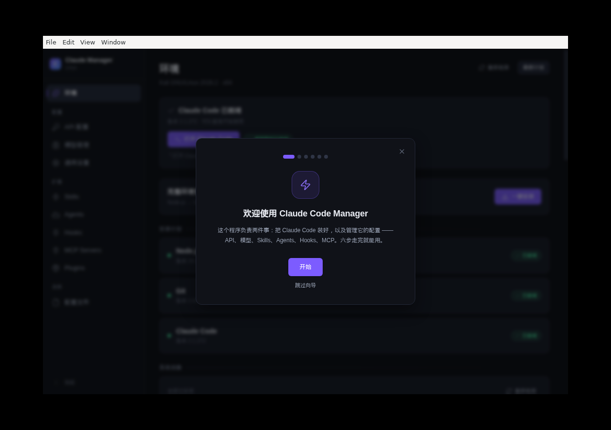
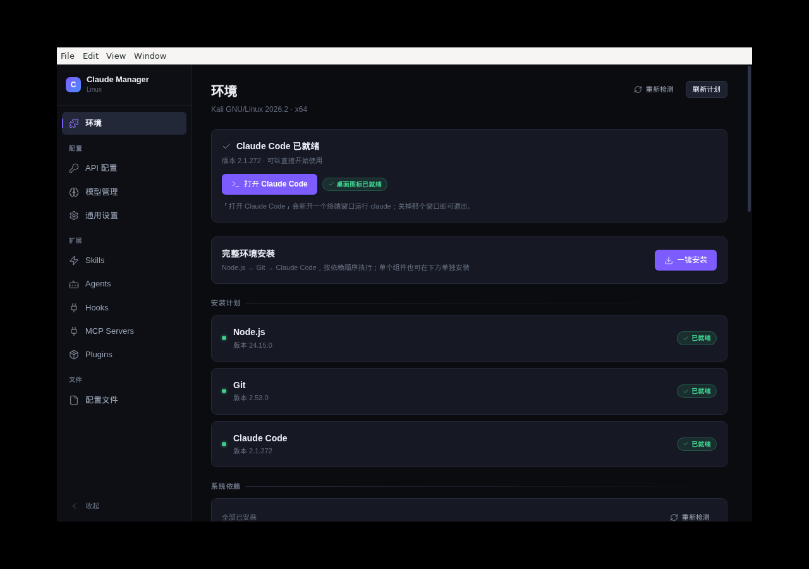
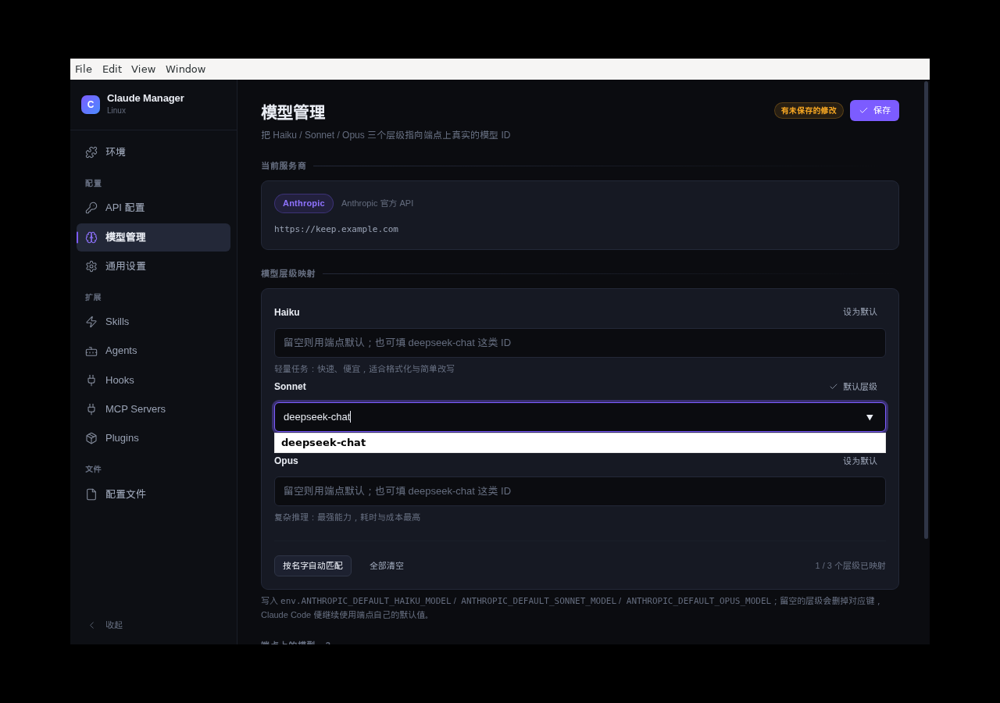

# Claude Code Manager — Linux 版（Kali / Debian）

Claude Code 一键安装与可视化管理工具，Linux 版源码。同时提供 **GUI 桌面版** 与 **CLI 终端版**。

- **GUI**：Electron + React + TypeScript，打包为 `.deb` / AppImage
- **CLI**：Rust + ratatui + crossterm，单文件 `ccm`（约 1 MB）

> 本目录是主仓库 [RRRadiant/claude-code-manager](https://github.com/RRRadiant/claude-code-manager)
> 的 Linux 子项目；Windows 版（Tauri）在仓库根目录。两版功能对齐，各自使用与平台相符的技术栈。
>
> Linux 版在 **Kali GNU/Linux 2026.1（x86_64）** 上开发并完成端到端实测，
> 验证记录见 [docs/kali-verification.md](docs/kali-verification.md)。

<p align="center">
  
  
  
</p>

## 快速开始

### 方式一：`.deb`（Debian / Ubuntu / Kali，推荐）

从 [Releases](https://github.com/RRRadiant/claude-code-manager/releases) 下载
`CCM-Kali-<version>.zip`（内含 `.deb`、安装说明与校验值），解压后在文件夹里打开终端：

```bash
sha256sum -c 校验值.txt              # 可选：确认传输无损
sudo apt install ./claude-code-manager_1.3.7_amd64.deb
```

依赖（`libsecret-1-0`、`gnome-keyring`）由 APT 自动解决。装完从应用菜单搜索
「Claude Code Manager」，或终端执行 `claude-code-manager`。

> 注意命令是 `claude-code-manager`，不是 `ccm` —— `ccm` 是另一个独立的终端工具。

卸载：`sudo apt remove claude-code-manager`

详见仓库内用户操作指引：[resources/linux/安装说明.txt](resources/linux/安装说明.txt)。

### 方式二：AppImage

把 AppImage 和启动脚本放在同一目录，运行脚本（会自动处理 FUSE 缺失与沙箱无法初始化）：

```bash
chmod +x ClaudeCodeManager.sh
./ClaudeCodeManager.sh
```

> 直接双击 AppImage 只在装了 FUSE 2 的机器上可行。AppImage 在部分新系统上「双击没反应」
> 的完整原因与修法见 [docs/distribution.md](docs/distribution.md)。

### 方式三：CLI 终端版

```bash
cd cli/ccm-tui
bash install.sh        # 安装到 ~/.local/bin/ccm
ccm
```

按键：`1`–`8` 跳转标签页，`Tab` 切换，`↑↓`/`j k` 移动，`Enter` 确认，`n` 新建，`d` 删除，`q` 退出。

## 界面

| 首次运行向导 | 环境面板 | 模型层级映射 |
|---|---|---|
|  |  |  |

其余截图见 [docs/screenshots/](docs/screenshots/)。

## 功能覆盖

| 功能 | GUI | CLI |
|---|:---:|:---:|
| 一键安装 Claude Code CLI | ✅ | ✅ |
| 多供应商 API 配置 | ✅ | ✅ |
| 模型检测与映射 | ✅ | ✅ |
| Skills（斜杠命令）CRUD | ✅ | ✅ |
| Agents（自定义代理）CRUD | ✅ | ✅ |
| Hooks（13 个生命周期） | ✅ | — |
| MCP Servers（stdio / sse） | ✅ | — |
| 配置文件编辑（Monaco） | ✅ | ✅ |
| Plugins + Marketplace | ✅ | — |
| 系统依赖检测 / 安装 | ✅ | — |
| 已有配置扫描与导入 | ✅ | — |
| 桌面快捷方式 | ✅ | — |

## 目录结构

```
linux/
├── src/                      # Electron GUI 源码
│   ├── main/                 # 主进程：IPC、CLI 检测、安装管线、系统依赖、桌面快捷方式
│   ├── preload/              # contextBridge API
│   └── renderer/             # React 前端（Tailwind v4 + Monaco + Zustand）
├── cli/
│   ├── ccm                   # CLI 入口脚本
│   └── ccm-tui/              # Rust TUI 源码（ratatui + crossterm）
│       ├── src/              # 事件循环 / 配置读写 / 8 个标签页
│       └── dist/             # 预编译二进制（x64 / arm64 / macOS arm64）
├── resources/linux/          # 图标、桌面入口、打包脚本（postinst / postrm / AppRun）
├── scripts/                  # 构建、交付与验证脚本
├── tests/                    # 单元测试
├── tools/                    # Kali 测试 VM 辅助脚本
├── docs/                     # Kali 验证报告、分发说明、UI 约定
├── package.json              # Electron / electron-builder 配置
└── electron.vite.config.ts
```

## 开发

```bash
npm install --legacy-peer-deps   # peer 依赖有冲突，必须带这个标志
npm run dev                      # Electron 开发模式（HMR）
npm run typecheck                # TypeScript 类型检查
npm test                         # 单元测试（约 80 项）
npm run build                    # 只构建，不打包
npm run package:deb              # 打 .deb（x64 / arm64）
npm run package:appimage         # 打 AppImage
```

CLI：

```bash
cd cli/ccm-tui
cargo build --release            # 本机目标
cargo test                       # Rust 单元测试
```

> 构建环境：Node.js 20+；打包 `.deb` / AppImage 需要在 Linux 上进行；
> 构建 CLI 需要 Rust 1.77+。
>
> 国内网络下 electron-builder 从 GitHub 拉取 Electron 会被限速，可改用镜像：
>
> ```bash
> ELECTRON_MIRROR="https://cdn.npmmirror.com/binaries/electron/" \
> ELECTRON_BUILDER_BINARIES_MIRROR="https://cdn.npmmirror.com/binaries/electron-builder-binaries/" \
> npm run package:deb
> ```

## 文档

| 文档 | 内容 |
|---|---|
| [docs/kali-verification.md](docs/kali-verification.md) | Kali 实机验证报告（安装管线、GUI、CLI、回归记录） |
| [docs/distribution.md](docs/distribution.md) | 分发说明：deb / AppImage / CLI 的选择与常见启动问题 |
| [docs/panel-ui-conventions.md](docs/panel-ui-conventions.md) | 面板 UI 约定 |
| [HANDOFF.md](HANDOFF.md) | 开发交接文档（架构、构建、发布流程） |
| [resources/linux/安装说明.txt](resources/linux/安装说明.txt) | 发给最终用户的安装说明 |

## 已知问题

1. **AppImage 依赖 FUSE 2**：Ubuntu 24.04+ 默认不装（包名 `libfuse2t64`），最小安装用户会打不开；
   Debian 系优先用 `.deb`。
2. **Chromium 沙箱**：AppImage 内的 `chrome-sandbox` 无法带 setuid 位，新系统默认限制未特权
   用户命名空间时启动即退出，从桌面入口双击看不到任何报错。用启动脚本或 `.deb` 可规避。
3. **arm64 未在真实 Kali 上实测**：本地可交叉编译，但发布前应以 x64 为准。
4. `cli/ccm-tui/dist/` 里的预编译二进制构建于若干修复之前，**发布时建议从源码重新构建**。
5. CLI 不提供 Hooks / Plugins / MCP 管理，这些仅 GUI 支持。

## 许可证

MIT —— 详见 [LICENSE](LICENSE)（与仓库根目录许可一致）。
